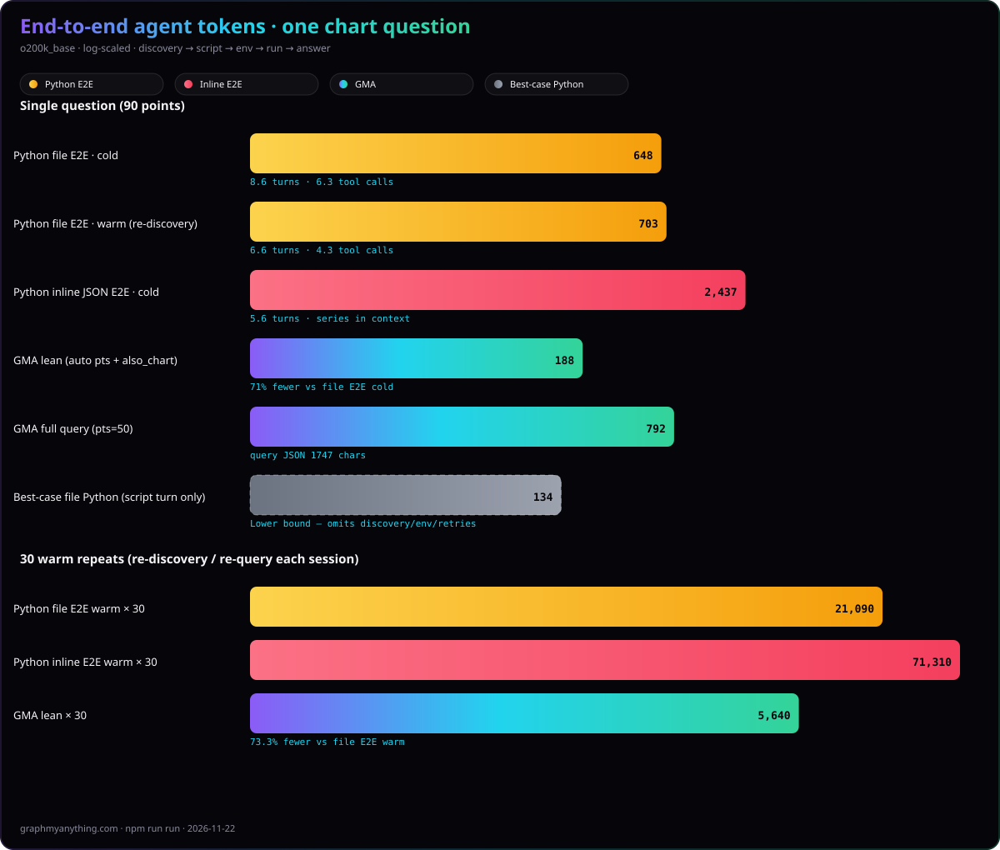

# Token benchmark (end-to-end)

## Headline (defensible)

**Best-case file Python (~134 tokens) is ~5× too low.** Measured **end-to-end** file flow (search → locate → schema → script → pip → run → answer): **648** tokens (8.6 turns, 6.3 tool calls).

**GMA lean (`points=auto`, `also_chart`):** 115 in / 73 out = **188** vs file E2E cold (188 vs 648 (71% fewer)). **GMA full (`points=50`):** **792** (719 in · 73 out).

**vs inline JSON E2E:** lean 188 vs 2,437 (92.3% fewer).

**30 warm sessions:** file E2E 21,090 · GMA lean 5,640 · inline 71,310.

**Cost @ 1,000 Q (GPT-5.2, in $1.75/M · out $14/M):** file E2E cold **$5.86** · GMA lean **$1.22** · GMA full **$2.28**.

## Assumptions (transparent)

| Item | Value |
|------|--------|
| User prompt | "Chart my last 90 days of MRR and tell me the trend." |
| Data size | 90 daily MRR points (synthetic) |
| Tokenizer | `js-tiktoken` / `o200k_base` |
| Token rule | Tool results enter context (input). Assistant text and tool-call args are output. |
| GMA lean query | `points=auto` + `also_chart=true` → summary only (`s.*` terse keys) |
| GMA full query | `points=50` — LTTB series in `pts` |
| Error+fix retry | 30% of flows; fail+fix steps weighted in totals |
| Warm session | Agent has **no memory** of prior script; re-lists / re-attaches data |
| GMA ingestion | **n8n/cron `track`** — 0 tokens inside question flow |
| Best-case Python | Single code-gen turn only; data path stated, not discovered |
| Cost model | GPT-5.2: $1.75/1M in, $14/1M out |

### E2E step model (Python file cold)

- **Plan + search tools** — Model emits codebase_search and rg calls (2 tool calls)
- **Search results** — Tool results return to context (0 tool calls)
- **list_dir + glob** — Model calls filesystem tools (2 tool calls)
- **Listing results** — Directory listings in context (0 tool calls)
- **Schema preview** — Head rows tool result in context (0 tool calls)
- **pip / import check** — Model runs env tools (1 tool calls)
- **pip install results** — stderr/stdout from tools in context (1 tool calls)
- **Run stdout + answer** — stdout tool result + model summary (0 tool calls)
- **Run failure (stderr)** — 30% weighted (0 tool calls, weight 0.3)
- **Fix + re-run stdout** — Weighted retry path (1 tool calls, weight 0.3)

## End-to-end token totals

| Flow | Input (context) | Output (model) | **Total** | Turns | Tool calls |
|------|-----------------|----------------|-----------|-------|------------|
| Python file E2E (cold start) | 262 | 386 | **648** | 8.6 | 6.3 |
| Python file E2E (warm, re-discovery) | 180 | 523 | **703** | 6.6 | 4.3 |
| Python inline JSON E2E (cold) | 1,219 | 1,218 | **2,437** | 5.6 | 3.3 |
| Python inline JSON E2E (warm) | 1,170 | 1,207 | **2,377** | 4.6 | 2.3 |
| GMA query+chart lean (auto pts, also_chart) | 115 | 73 | **188** | 3 | 2 |
| GMA query+chart full (pts=50) | 719 | 73 | **792** | 3 | 2 |
| Best-case file Python (1 turn) | 56 | 78 | **134** | 1 | 0 |

## Per-step breakdown (auditable)

### Python file E2E (cold start)

| Step | In (context) | Out (model) | Total |
|------|----------------|-------------|-------|
| Plan + search tools | 17 | 36 | 53 |
| Search results | 57 | 18 | 75 |
| list_dir + glob | 8 | 22 | 30 |
| Listing results | 36 | 19 | 55 |
| Schema preview | 56 | 229 | 285 |
| pip / import check | 10 | 12 | 22 |
| pip install results | 31 | 14 | 45 |
| Run stdout + answer | 33 | 30 | 63 |
| Run failure (stderr) | 6 | 3 | 9 |
| Fix + re-run stdout | 8 | 3 | 11 |
| **Sum** | **262** | **386** | **648** |

### Python file E2E (warm, re-discovery)

| Step | In (context) | Out (model) | Total |
|------|----------------|-------------|-------|
| Re-discovery tools | 17 | 17 | 34 |
| Re-discovery results | 39 | 12 | 51 |
| Rewrite script | 8 | 215 | 223 |
| Schema preview | 56 | 229 | 285 |
| pip show | 13 | 14 | 27 |
| Run stdout + answer | 33 | 30 | 63 |
| Run failure (stderr) | 6 | 3 | 9 |
| Fix + re-run stdout | 8 | 3 | 11 |
| **Sum** | **180** | **523** | **703** |

### Python inline JSON E2E (cold)

| Step | In (context) | Out (model) | Total |
|------|----------------|-------------|-------|
| Search + attach JSON | 1,125 | 8 | 1,133 |
| Inline matplotlib script | 6 | 1,148 | 1,154 |
| pip / import check | 10 | 12 | 22 |
| pip install results | 31 | 14 | 45 |
| Run stdout + answer | 33 | 30 | 63 |
| Run failure (stderr) | 6 | 3 | 9 |
| Fix + re-run stdout | 8 | 3 | 11 |
| **Sum** | **1,219** | **1,218** | **2,437** |

### Python inline JSON E2E (warm)

| Step | In (context) | Out (model) | Total |
|------|----------------|-------------|-------|
| Re-attach series | 1,104 | 9 | 1,113 |
| Inline matplotlib script | 6 | 1,148 | 1,154 |
| pip show | 13 | 14 | 27 |
| Run stdout + answer | 33 | 30 | 63 |
| Run failure (stderr) | 6 | 3 | 9 |
| Fix + re-run stdout | 8 | 3 | 11 |
| **Sum** | **1,170** | **1,207** | **2,377** |

### GMA query+chart lean (auto pts, also_chart)

| Step | In (context) | Out (model) | Total |
|------|----------------|-------------|-------|
| query call | 17 | 32 | 49 |
| query tool result → chart call | 59 | 22 | 81 |
| chart tool result | 39 | 19 | 58 |
| **Sum** | **115** | **73** | **188** |

### GMA query+chart full (pts=50)

| Step | In (context) | Out (model) | Total |
|------|----------------|-------------|-------|
| query call | 17 | 32 | 49 |
| query tool result → chart call | 663 | 22 | 685 |
| chart tool result | 39 | 19 | 58 |
| **Sum** | **719** | **73** | **792** |

## $ cost per 1,000 identical questions

| Flow | Tokens / question | Est. API cost |
|------|-------------------|---------------|
| Python file E2E cold | 648 | $5.86 |
| Python file E2E warm | 703 | $7.64 |
| GMA lean | 188 | $1.22 |
| GMA full pts=50 | 792 | $2.28 |
| Best-case file Python | 134 | $1.19 |

Pricing: [GPT-5.2](https://platform.openai.com/docs/pricing).

## 30-session warm cumulative

| Flow | Per session | × 30 |
|------|-------------|-------------|
| Python file E2E warm | 703 | **21,090** |
| Python inline E2E warm | 2,377 | **71,310** |
| GMA lean | 188 | **5,640** |

## Answer quality (same prompt)

| Flow | Trend | % change | Anomalies w/o extra chat |
|------|-------|----------|---------------------------|
| Python E2E | Printed in stdout | Printed | No (+1 turn typical) |
| GMA query + chart | `summary.trend=up` | `summary.pct_change=14.68` | Use `insight` tool |
| GMA + insight | Yes | Yes | Yes (5 in synthetic run) |

## Caveats

- Modeled flows, not live agent traces; token counts are **reproducible** from step text in `e2e-flows.ts`.
- **Best-case** row is a deliberate lower bound; citing it without E2E is misleading.
- File E2E assumes the agent does not paste the whole JSON into chat when told to read from disk.
- GMA `chart` returns a path, not image bytes (same as Python PNG on disk).
- Other model tokenizers differ slightly; dollar lines scale linearly with token split.

## Reproduce

```bash
cd benchmarks/token-benchmark
npm install
npm run run
```

From repo root: `npm run benchmark:tokens`


