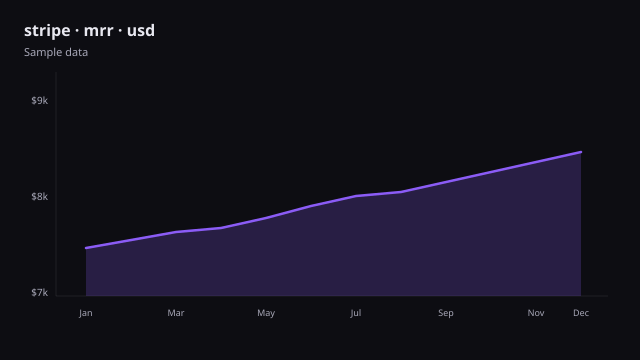

# Stripe MRR connector

Pull month-normalized MRR, subscriber counts, expansion/contraction, and net cash revenue from Stripe into GraphMyAnything — one SQLite series per currency, aligned with Stripe Billing Analytics rules.

## Quick start

1. Create a **restricted read-only** API key in the Stripe Dashboard (`rk_test_…` or `rk_live_…`). Do **not** use a secret key (`sk_…`).
2. Grant **Read** access to: subscriptions, customers, invoices, prices, products, coupons, promotion codes, credit notes, refunds/charges.
3. Install / build `graphmyanything-stripe` from this repo (`packages/stripe-mrr`).
4. Point both the CLI and `graphmyanything-mcp` at the same DB (default `~/.graphmyanything/metrics.db`).

```bash
export STRIPE_RESTRICTED_KEY=rk_test_…
npx graphmyanything-stripe backfill   # one-time history
npx graphmyanything-stripe sync       # today's UTC snapshot
npx graphmyanything-stripe status
```

## Metric names

| Metric | Meaning |
|--------|---------|
| `stripe.mrr.usd` (etc.) | Licensed MRR for that currency (lowercase ISO code) |
| `stripe.subscribers` | Active + past_due subs (no trial, not paused) |
| `stripe.mrr.new.usd` | Day-over-day expansion in that currency |
| `stripe.mrr.churned.usd` | Day-over-day contraction in that currency |
| `stripe.revenue.net.usd` | Cash: invoices paid that day minus refunds & credit notes |

Currencies are **never** mixed through FX — chart/query each `stripe.mrr.<ccy>` separately.

## MRR rules (summary)

- **Counts:** `active` and `past_due` subscriptions.
- **Excludes:** tax lines, metered/usage items, trials (until converted), paused subs.
- **Intervals:** annual ÷12, weekly ×52÷12, and proportional treatment for other billing periods.
- **Discounts:** forever, repeating (while active), once (single invoice period), 100% off → 0.
- **`cancel_at_period_end`:** still in MRR until the period ends.

Backfill reconstructs daily UTC-midnight history from **subscription** (`status=all`) and **invoice** lists. Stripe Events only cover ~30 days, so the connector does not rely on them for history.

## n8n daily workflow

Import [`integrations/n8n/track-stripe-mrr-daily.json`](../integrations/n8n/track-stripe-mrr-daily.json). The **Stripe sync (CLI)** node runs `graphmyanything-stripe sync` using a Stripe API credential that holds your **restricted** key (`rk_…`).

Then MCP nodes `query` / `insight` / `chart` on `stripe.mrr.usd` (90d).

## Example agent questions

After sync or backfill, ask your agent (via GraphMyAnything MCP):

- “What is our USD MRR trend over the last 90 days?”
- “How many subscribers do we have, and how did `stripe.mrr.new.usd` compare to `stripe.mrr.churned.usd` last week?”
- “Chart `stripe.mrr.usd` for the last 12 months.”
- “What was net cash (`stripe.revenue.net.usd`) yesterday vs trailing 30 days?”

## Sample chart

Synthetic ~$8k/mo SaaS curve (not live data):



Caption: **Sample data** — illustrative only.

## Hosted mode

Set `GRAPHMYANYTHING_API_KEY` (the key saved by `npx -y graphmyanything-mcp@latest sync`, or one from your account page) and the CLI also uploads each run to your hosted account after writing locally, so your live chart links stay current. Local SQLite is always written too.