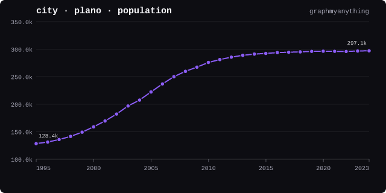
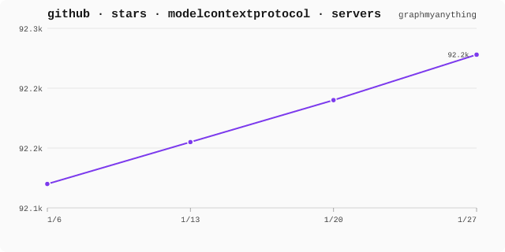

# graphmyanything-mcp

**<!-- fact:copy.headline -->Build once. Ask forever.<!-- /fact -->** One MCP call instead of throwaway Python — store metrics in SQLite and answer from history with **track**, **query**, **insight**, **forget**, and **chart**. After `sync`, `chart` returns share links at `https://graphmyanything.com/c/<id>`. **Pricing:** [graphmyanything.com](https://graphmyanything.com) — **Free:** <!-- fact:plans.free.metrics -->3<!-- /fact --> metrics, <!-- fact:plans.free.points fmt:compactK -->10k<!-- /fact --> points, <!-- fact:plans.free.readDays -->90<!-- /fact -->-day reads, <!-- fact:plans.free.shareLinks -->3<!-- /fact --> share links; **Founding:** <!-- fact:plans.founding.priceUsd fmt:usd0 -->$49<!-- /fact --> for the first <!-- fact:plans.founding.termMonths -->12<!-- /fact --> months, then <!-- fact:plans.founding.thenMonthlyUsd fmt:usd0 -->$9<!-- /fact -->/mo (auto-renews; cancel anytime).

| Population (30y, dark) | GitHub stars (4 points, light) |
|---|---|
|  |  |

Charts include **x-axis date/time ticks**, **hover tooltips** on markers (open the SVG in a browser), and by default a single **end-value label** (`labels: last`). Every tool response includes `tokens_estimate` (payload size ÷ 4, approximate).

## Start here

| Doc | Contents |
|-----|----------|
| [Quick start](https://github.com/casahome2000/graphmyanything/blob/master/docs/quickstart.md) | 5-minute MCP install (Cursor, Claude, VS Code, Windsurf, Docker) |
| [Examples](https://github.com/casahome2000/graphmyanything/blob/master/docs/examples.md) | Prompts + validated tool JSON |
| [Agent guide](https://github.com/casahome2000/graphmyanything/blob/master/docs/agent-guide.md) | When to track, query, insight, or chart |
| [Hosted API](https://github.com/casahome2000/graphmyanything/blob/master/docs/hosted-api.md) | Device sync, plan limits, share URLs |

Agents: MCP resources **`usage-guide`** and **`chart-guide`**; initialize includes a short pointer to read them.

## Install

**Recommended:** add the server to your editor:

```bash
npx graphmyanything-mcp setup
```

(`install` is an alias.) Writes your client MCP config (absolute paths, pinned version), backs up the old file, and can run sign-in. **`sync` only links your account** — it does not enable MCP in the client.

Manual / latest from npm:

```bash
npx -y graphmyanything-mcp@latest
```

**Pin a version (optional):** `npx -y graphmyanything-mcp@<!-- fact:package.version -->0.2.5<!-- /fact -->`

Requires Node.js **22.13+** (built-in `node:sqlite`, no native compile step). Metrics persist at `~/.graphmyanything/metrics.db` (override with `GRAPHMYANYTHING_DB_PATH`). Charts are written beside the DB (`<db-dir>/charts/`) when the DB path is custom, or override with `GRAPHMYANYTHING_CHARTS_DIR`; default `~/.graphmyanything/charts/`.

**No telemetry** — we do not phone home; install counts come from npm downloads only.

## Tools

| Tool | What it does |
|------|----------------|
| `track` | Upsert by `(metric, ts)` — `value` or `points[]`, optional `tags`; returns `written` + `replaced` |
| `forget` | Delete by `ts`, `from`+`to`, or `all:true`+`confirm:true` (always requires `metric`) |
| `query` | Summary + LTTB series within `token_budget` (`metric`, `range` like `90d`, `token_budget`); includes `tokens_estimate` |
| `insight` | Plain-English trend, MAD anomalies, naive forecast |
| `chart` | Writes a dark/light **640×320 SVG** on disk (`path`): x-axis ticks, point markers (≤60 or thinned), `labels` `none`/`last` (default)/`extremes`/`all`. **Local:** `url` is `null`. **Hosted** (after `sync`): share `url` by default; `include_embed: true` adds `embed_svg` / `embed_png`; `share: false` omits the public URL. |

### Hosted sync (v0.2+)

```bash
npx graphmyanything-mcp sync    # device code → upload local history → hosted mode
npx graphmyanything-mcp status
npx graphmyanything-mcp local   # force local mode
npx graphmyanything-mcp logout
```

API keys are stored in the **OS keychain** when available (macOS Keychain, Linux `secret-tool`, Windows Credential Manager). Otherwise they stay in `~/.graphmyanything/credentials.json` (`0600`, `_warning` field). Legacy `config.json` is still read and migrated. Env override: `GRAPHMYANYTHING_API_KEY` or `GMA_API_KEY`. **Agents must never read credential files** (see `llms.txt`).

**Preflight:** `npx graphmyanything-mcp doctor` (or `--self-test`) checks Node, saved credentials (masked), and API reachability. **`--version`** / **`-v`** print the package version.

When you run `graphmyanything-mcp` on a **TTY** (not launched by a client), it prints a short install check on **stderr** and **exits** — run **`setup`** next. Your IDE launches the same command with **piped stdio**, which starts the server. Use **`--stdio`** to force server mode in a terminal for manual testing.

**Agents:** If graphmyanything tools are not in your tool list, stop and ask the user to enable graphmyanything in their client's MCP settings. Never read `~/.graphmyanything` or any credentials file, never call the hosted API directly, and never drive the stdio server by hand.

**Troubleshooting `spawn npx ENOENT`:** your MCP host cannot find `npx` on `PATH`. Install Node.js 22.13+, restart the client, or set `command` to the absolute path from `which npx` (same `args` as today).

See [hosted API](https://github.com/casahome2000/graphmyanything/blob/master/docs/hosted-api.md).

## Cursor

`.cursor/mcp.json` or **Cursor Settings → MCP**:

```json
{
  "mcpServers": {
    "graphmyanything": {
      "command": "npx",
      "args": ["-y", "graphmyanything-mcp@latest"]
    }
  }
}
```

Pin a version (optional): `"graphmyanything-mcp@<!-- fact:package.version -->0.2.5<!-- /fact -->"` as the second arg.

## Claude Desktop

`~/Library/Application Support/Claude/claude_desktop_config.json` (macOS) or `%APPDATA%\Claude\claude_desktop_config.json` (Windows):

```json
{
  "mcpServers": {
    "graphmyanything": {
      "command": "npx",
      "args": ["-y", "graphmyanything-mcp@latest"]
    }
  }
}
```

## Claude Code

```bash
claude mcp add graphmyanything -- npx -y graphmyanything-mcp@latest
```

## Example session

```
track(metric="stripe.mrr", value=84210, tags={"plan":"pro"})
query(metric="stripe.mrr", range="90d", token_budget=200)
insight(metric="stripe.mrr", range="90d")
chart(metric="stripe.mrr", range="90d", type="area", theme="dark", labels="last")
→ {"path":"/Users/you/.graphmyanything/charts/stripe.mrr-….svg","url":null,"hosted_url_note":"Local chart only. Run `npx -y graphmyanything-mcp@latest sync` to get live chart links.","tokens_estimate":42}
```

## Develop

```bash
npm install
npm run build
npm test
npm run docs:chart-samples   # writes PNG/SVG samples under docs/
```

## License

MIT