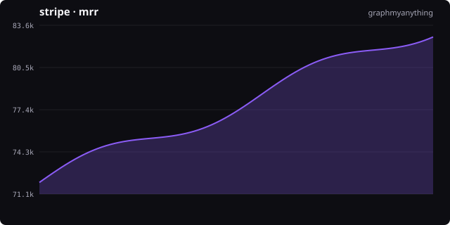

# graphmyanything-mcp

**One call instead of throwaway Python.** Local-first [MCP](https://modelcontextprotocol.io) server that stores metrics in SQLite and returns token-efficient summaries, insights, and charts for AI agents.

[Join the waitlist](https://graphmyanything.com) · Founding member preorder live on the site.



## Install

```bash
npx graphmyanything-mcp
```

Requires Node.js **22.13+** (built-in `node:sqlite`, no native compile step). Metrics persist at `~/.graphmyanything/metrics.db` (override with `GRAPHMYANYTHING_DB_PATH`).

**No telemetry** — we do not phone home; install counts come from npm downloads only.

## Tools

| Tool | What it does |
|------|----------------|
| `track` | Record a value, batch, or historical points (`metric`, `value` or `points[]`, optional `tags`) |
| `query` | Summary + LTTB series within `token_budget` (`metric`, `range` like `90d`, `token_budget`) |
| `insight` | Plain-English trend, MAD anomalies, naive forecast |
| `chart` | Dark-theme SVG to `~/.graphmyanything/charts/` (`type`: line \| bar \| area) |

Permanent live chart URLs at **https://graphmyanything.com/c/&lt;metric&gt;** are coming for founding members.

## Cursor

`.cursor/mcp.json` or **Cursor Settings → MCP**:

```json
{
  "mcpServers": {
    "graphmyanything": {
      "command": "npx",
      "args": ["-y", "graphmyanything-mcp"]
    }
  }
}
```

## Claude Desktop

`~/Library/Application Support/Claude/claude_desktop_config.json` (macOS) or `%APPDATA%\Claude\claude_desktop_config.json` (Windows):

```json
{
  "mcpServers": {
    "graphmyanything": {
      "command": "npx",
      "args": ["-y", "graphmyanything-mcp"]
    }
  }
}
```

## Claude Code

```bash
claude mcp add graphmyanything -- npx -y graphmyanything-mcp
```

## Example session

```
track(metric="stripe.mrr", value=84210, tags={"plan":"pro"})
query(metric="stripe.mrr", range="90d", token_budget=200)
insight(metric="stripe.mrr", range="90d")
chart(metric="stripe.mrr", range="90d", type="area", theme="dark")
```

## Develop

```bash
npm install
npm run build
npm test
```

## License

MIT